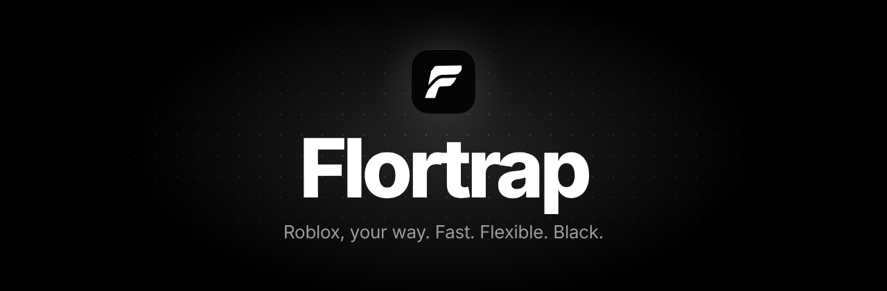
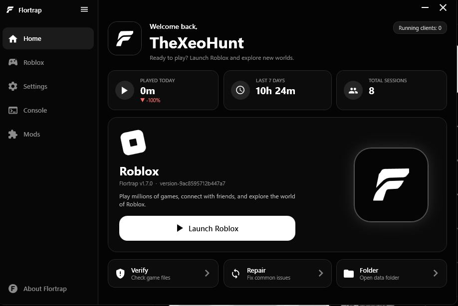

<div align="center">



<br>

<a href="https://github.com/slenderhold/Flortrap/raw/main/download/Flortrap-Setup.exe"></a>
<a href="https://slenderhold.github.io/Flortrap/"></a>
<a href="https://discord.gg/nPeHUyxYBA"></a>

<br>


<br><br>

<b>Flexible · Optimized · Pleasant · Light</b><br>
<sub>A custom Roblox launcher for Windows with a black interface, engine tuning, mods and Discord status.</sub>

<br><br>

<a href="#-why-flortrap">Why</a> ·
<a href="#-features">Features</a> ·
<a href="#-installation">Install</a> ·
<a href="#-mods">Mods</a> ·
<a href="#-faq">FAQ</a> ·
<a href="#-support">Support</a>

<br><br>



</div>

<br>

## ✦ Why Flortrap

<table>
<tr>
<td width="25%" align="center"><h3>🎛<br>Flexible</h3><sub>Engine, graphics, flags and mods. Turn on only what you need.</sub></td>
<td width="25%" align="center"><h3>⚡<br>Optimized</h3><sub>FPS unlock, background limit, process priority and cache cleanup.</sub></td>
<td width="25%" align="center"><h3>🖤<br>Pleasant</h3><sub>Black theme, custom background and GIF, smooth animations.</sub></td>
<td width="25%" align="center"><h3>🪶<br>Light</h3><sub>Hides to tray, no extra services, no admin rights.</sub></td>
</tr>
</table>

<br>

## ✦ Features

<table>
<tr>
<td width="33%" valign="top"><h3>🚀 Fast launch</h3>Starts Roblox, updates it and applies your settings in one click.</td>
<td width="33%" valign="top"><h3>⚙️ Engine settings</h3>FPS limit and unlock, textures, MFAA, FXAA, DirectX / Vulkan / OpenGL, reserved RAM.</td>
<td width="33%" valign="top"><h3>🚩 FastFlags</h3>Add and import your own flags. Off by default, applied on every launch.</td>
</tr>
<tr>
<td valign="top"><h3>🧩 Mods</h3>A catalog with banners. Download, and the mod switches itself on.</td>
<td valign="top"><h3>🌍 Region servers</h3>Pick a region and join a public server of the game there.</td>
<td valign="top"><h3>🖼 Custom background</h3>Image or GIF with smoothing up to 120 FPS, transparency and frosted glass.</td>
</tr>
<tr>
<td valign="top"><h3>📊 Play stats</h3>Time played today and this week, sessions and running clients.</td>
<td valign="top"><h3>💬 Discord status</h3>Friends see what you play and can join.</td>
<td valign="top"><h3>🔄 Auto-update</h3>New releases download themselves. Old version out, new version stays.</td>
</tr>
<tr>
<td valign="top"><h3>🖥 Multi-instance</h3>Run several Roblox clients at once.</td>
<td valign="top"><h3>🛠 Verify and repair</h3>Check game files, fix common problems, clear the cache.</td>
<td valign="top"><h3>🛡 No admin rights</h3>Per-user installer, data in <code>C:\FRoblox</code>.</td>
</tr>
</table>

<br>

## ✦ Installation

| | Step |
|:-:|:--|
| **1** | Download **[Flortrap-Setup.exe](https://github.com/slenderhold/Flortrap/raw/main/download/Flortrap-Setup.exe)** from the [Releases](https://github.com/slenderhold/Flortrap/releases) page. |
| **2** | Run it. Pick a folder and shortcuts. **No administrator rights needed.** |
| **3** | When the ring fills and the white check mark appears, open Flortrap and press **Launch Roblox**. |

Running the installer again offers to reinstall. To uninstall, use **Settings → Apps**. Your data and Roblox stay in `C:\FRoblox`.

<br>

## ✦ Mods

A mod is a folder with a `mod.json`: FastFlags and files to replace (for example the cursor). Mods never run code.

```json
{
  "id": "my-mod",
  "name": "My Mod",
  "description": "Turns shadows off.",
  "version": "1.0.0",
  "flags": { "FIntRenderShadowIntensity": 0 }
}
```

📖 Full guide: **[docs/MODS.md](docs/MODS.md)** · it is also shown at the bottom of the **Mods** tab.
To publish a mod, add it to `mods/catalog.json` and open a pull request.

<br>

## ✦ FAQ

<details>
<summary><b>Do I need administrator rights?</b></summary>
<br>No. The installer puts Flortrap in your own folder.
</details>

<details>
<summary><b>Is this the official Roblox launcher?</b></summary>
<br>No. Flortrap is independent and not affiliated with Roblox Corporation. Use the settings at your own risk: Roblox can change its rules and ignore some FastFlags.
</details>

<details>
<summary><b>Are mods safe?</b></summary>
<br>Mods are data only (flags and assets). Executables and scripts are never unpacked, and replacement paths are limited to Roblox content folders.
</details>

<details>
<summary><b>What if I run into a problem?</b></summary>
<br>If you have a problem or a question, you can reach out in our <a href="https://discord.gg/nPeHUyxYBA">Discord Server</a>.
</details>

<br>

## ✦ Support

<div align="center">

**Problem or question?** Ask in our **[Discord Server](https://discord.gg/nPeHUyxYBA)**.
Found a bug? [Open an issue](https://github.com/slenderhold/Flortrap/issues).

<a href="https://discord.gg/nPeHUyxYBA"></a>

</div>

<br>

## ✦ Build from source

Requires Windows. The .NET 8 SDK is downloaded automatically if missing.

```bat
git clone https://github.com/slenderhold/Flortrap
cd Flortrap
build-installer.bat
:: result: dist\Flortrap-Setup.exe
```

Keep the version in `Flortrap\Flortrap.csproj` and `Flortrap.Setup\Flortrap.Setup.csproj` equal, and tag releases with a higher number than the installed build so auto-update sees them.

<br>

<div align="center">
<sub>Flortrap is not affiliated with Roblox Corporation. · <a href="LICENSE">License</a></sub>
</div>
